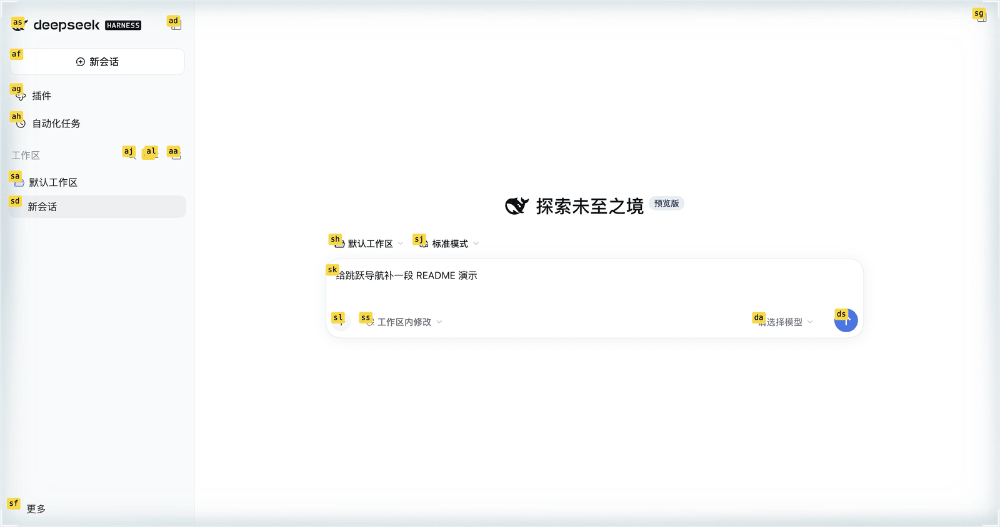

# dsh-plugins

Lionad 的 [DeepSeek Harness](https://github.com/deepseek-ai) 插件集合。



## 包

| 包 | 说明 |
| --- | --- |
| [`dsh-client-ui-skin-ascii-rest`](packages/dsh-client-ui-skin-ascii-rest) | 以 ascii.rest 场景作工作区背景的皮肤，随亮暗主题换配色，可在设置页切换 34 个场景并用 lil-gui 调参 |
| [`ascii-rest-scenes`](packages/ascii-rest-scenes) | 上面那个皮肤用到的纯逻辑层：场景目录、cover 取景、调色板与纸色转换、设置归一化 |
| [`dsh-jump`](packages/dsh-jump) | 键盘跳跃导航，web profile 专用：组合键（默认 Cmd+H / Cmd+U，可在设置里录制改键）给可点击元素打 label，按键即点或即聚焦，Esc 退出 |
| [`dsh-better-keybindings`](packages/dsh-better-keybindings) | 键盘修正，web 与 desktop profile 共用：输入框聚焦时 Home/End 把光标移到行首行尾，不再把聊天区滚到顶或底 |
| [`dsh-slash-commands`](packages/dsh-slash-commands) | 三端 slash 命令：tui 的 `/copy` 把最近 n 轮最终回复放进系统剪贴板（`--all` 连你的发言一起带），web 与 desktop 的 `/rename` 改当前会话标题、`/resume` 切换到另一个会话 |

## 安装皮肤

皮肤通过 harness 的 Loader row 挂载。两种方式：

**A. 以 profile 依赖安装（推荐，管理器可直接接管）**

在 `~/.dsh/profiles/desktop/package.json` 里加一条 link 或版本依赖，并把它加进 `dsh.profile.bundles`：

```json
{
  "dependencies": {
    "@lionad/dsh-client-ui-skin-ascii-rest": "link:/path/to/dsh-plugins/packages/dsh-client-ui-skin-ascii-rest"
  },
  "dsh": {
    "profile": {
      "bundles": ["...", "@lionad/dsh-client-ui-skin-ascii-rest"]
    }
  }
}
```

然后 `dsh plugin --profile desktop install`，重启 DSH。皮肤会自动启用，皮肤管理器（若已安装）在设置里能看到它。

**B. 手工 patch**

在 profile 的 `cordis.patch.yml` 末尾加：

```yaml
- insert:
    - id: ui-skin-ascii-rest
      name: '@lionad/dsh-client-ui-skin-ascii-rest'
```

注意这个文件的顶层必须始终是 YAML 数组，空的时候写 `[]`，只写注释会让 boot 直接失败。

安装后重启 DSH 一次。之后切换皮肤、调参、换场景都不再需要重启。

## 开发

```sh
pnpm install
pnpm build      # 产出 lib/（包内分块 + 主入口），lib 是要提交的，profile 直接读它
pnpm test       # 五个包递归，40 文件 529 用例
pnpm typecheck
```

`packages/*/lib/` 提交进仓库是刻意的：harness 的 profile 直接从安装包读 `lib/`，不会替你跑构建。改了 `src/` 就必须重新 build 再提交，否则安装态跑的是旧代码。

## 市场分发

`dsh-jump`、`dsh-better-keybindings`、`dsh-slash-commands` 三个包可以投进 DSH 插件市场与 awesome 社区目录。索引与条目都是生成物，从包自身的 `package.json` 与 `locale` 派生，别手改：

```sh
pnpm check:market            # 校验三个包的对外暴露面（宿主真正读取的字段）
pnpm build:market            # 重算 market/index.json，安装来源钉当前 commit
pnpm check:market-index      # 只校验不写盘
pnpm build:awesome dsh-jump  # 重算 market/awesome/<owner>__<repo>--<subdir>.yml
```

`check:market` 断言的是「别人装得动」这件事本身：`engines.dsh` 是显式的 `>=floor <ceiling` 区间且容纳本机运行态、icon 能经 `exports` 解析到、`dsh.bundle.patch` 是 `./` 相对路径且在 `files` 里、`locale/en.json` 有标题与描述、`npm pack` 产物不含 `src/` 与 `test/`、不带 install 生命周期脚本。任一失败即为不可发布，不是不整齐。

改过包元数据或发版后要重跑 `pnpm build:market`：索引里的安装来源是 `git+<repo>#<commit>&path:/packages/<name>`，commit 取自生成时刻的 HEAD，放着不重算就会指向旧提交。

## 更新上游 ascii.rest

场景来自 ascii.rest 的 git 依赖，目前钉在 `c556be4`（salt-flat 是在 v0.4.0 之后才加的，没进过 npm 版本）。升级步骤：

```sh
cd packages/dsh-client-ui-skin-ascii-rest
pnpm add "ascii.rest@github:bas3line/ascii#<new sha>"
pnpm --filter ascii-rest-scenes run build:catalog   # 重新生成场景目录
pnpm build && pnpm test
```

## 许可

本仓代码 MIT。场景图形来自 [ascii.rest](https://ascii.rest)，作者 bas3line，MIT。