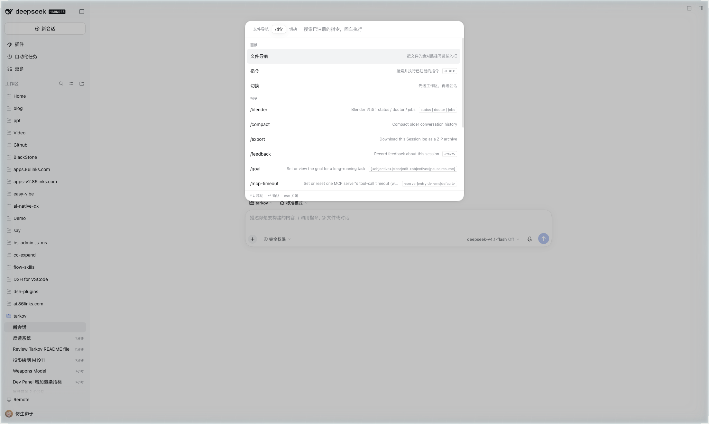

# dsh-command-panel

一个命令面板，把三件事收在一套检索与键盘语义下：

| 模式 | 键 | 做什么 |
| --- | --- | --- |
| 文件导航 | `⌘P` | 在宿主的有界文件索引里搜路径，回车把该文件的绝对路径写到输入框光标处，`⌘↵` 交给文件面板，`⇧↵` 在右侧栏打开；输入 4 位以上十六进制前缀时并行匹配 git 提交 |
| 指令 | `⌘⇧P` | 搜宿主注册表里的斜杠命令，回车执行；需要参数的命令把 `/name ` 写进输入框 |
| 切换 | `⌘O` | 先选工作区，再选该工作区的会话，选中即切换会话（等同点侧边栏） |

三个模式共用一套规则：打开即有内容、输入即筛选、`↑↓` 移动、`↵` 确认、`esc` 先退一层再关、关闭后焦点还给原处。面板自己也是挂载入口：每个模式里都有另外两个模式的入口行，所以从任意模式都能转到任意模式。



## 安装

包内 `lib/` 是提交入库的构建产物，profile 安装态直接读它、不跑构建。

**web profile**

```sh
dsh plugin --profile web add "link:/Users/lionad/Github/Lionad-Morotar/dsh-plugins/packages/dsh-command-panel"
```

`dsh plugin add` 会同时把包写进 `dsh.profile.bundles`。装完重启该 profile 的宿主进程。

**desktop profile**

desktop profile 由 Electron 应用独占管理，CLI 会拒绝写入。用设置里的插件管理器安装同一个 `link:` 路径，或在应用退出后手工加进 `~/.dsh/profiles/desktop/package.json` 的依赖与 `dsh.profile.bundles`，再 `pnpm install`。两条路都需要重启应用一次。

**手工 patch（不走包管理器时）**

在 profile 的 `cordis.patch.yml` 末尾加：

```yaml
- insert:
    - id: command-panel
      name: 'dsh-command-panel'
```

包的 `cordis.patch.yml` 里已经带了同一条，包管理器安装时不必重复。

## 键位：为什么 `⌘P` 和 `⌘O` 不是声明出来的默认值

宿主的快捷键服务在注册期就用**声明的默认值**校验重叠，且遍历六套 profile，与用户偏好无关。宿主自己已经声明了这两个键：

- `workspace.files` 默认 `⌘P`（侧栏文件树）
- `workspace.add` 默认 `⌘O`（添加工作区）

所以插件若把这两个键写进 `defaults`，注册会直接抛错。本插件的做法是：

1. `⌘⇧P` 在六套 profile 里都空闲，直接声明为默认值，装上即用。
2. `⌘P`、`⌘O` 不声明默认值，改为在激活后问一次服务：`describeBinding` 说这个组合在当前设备上没有 issue、也没有冲突，才写一条与"设置里改键"完全等价的显式覆盖（`shortcuts.edit`）；已被占用就留空并在控制台说明原因，绝不静默挤掉别人的绑定。

因此键位会出现在宿主的快捷键参考面板里，也可以随时在那里改掉。`⌘O` 在本机当前被用户自己绑给了 `session.new`，插件不会去抢；要它接管，给 Loader 行加配置：

```yaml
- id: command-panel
  name: 'dsh-command-panel'
  config:
    takeoverSwitch: true
```

打开后插件会先清掉占用者的显式覆盖，再写下自己的，也就是"设置里按两次"的自动化版本。

Web 端还有一层浏览器限制：宿主白名单不接受 `⌘P`、`⌘O` 这类"单修饰键 + 字母"的组合，所以 web profile 上这两个键不会被绑定（`⌘⇧P` 可以）。web 上要进另外两个模式，从命令模式的第一组行里选即可。

## 行为细节

**打开即有内容**：插件在会话就绪时预取一次文件候选与命令目录，面板打开时先渲染手上的行，再在后台刷新。命令模式在两处保证首帧非空：面板自带的模式行不需要宿主往返。

**会话行状态与侧栏同源**：切换模式的会话行与工作区行从 `sessions.list` 快照上顺带的 `sessionActivity` 投影读活跃度，与侧栏的蓝色阶梯同一份数据、同一组档位（一小时内强蓝、两小时内微蓝、五小时内淡蓝、超过交还面板原色；运行中恒为强蓝），工作区行按成员折叠取最新、归档成员仍计入因子，加粗只给工作区行、会话行永不加粗，所以同一会话不会在面板与侧栏读出两个活跃度。投影容器是宿主的形状，读取逐级窄化，读不出来就是不着色而不是报错。投影落定与档位跨界不改动任何摘要字段，因此目录指纹（signature）里并入活跃度戳，面板开着时另有每分钟一次的兜底重算，年龄文案不再冻结在打开那一刻；「运行中」徽标用语义绿而非中性灰。

**插入是追加，不是覆盖**：读写输入框走 session 槽位下发的 `inputActions`，用 `captureInsertion` 拿到的 span 做 CAS 插入，草稿与 `@` 引用 chip 都不动。宿主没下发 actions 时退回服务路径（`conversation.input.for(actx)`），同样按 span 追加；只有在草稿为空时才允许整体写入，所以失败也不会毁掉已输入的内容。插入时按两侧字符决定是否补一个空格，不会和已有文字粘在一起。

**头部只有输入框，模式由占位文案暗示**：三种模式不再各占一个页签。占位文案之所以能替代它，是因为页签只回答「现在在哪个模式」，而这个问题在字段为空时才有人问，占位文案正好在这时候说话。导航与切换的占位里带「> 切指令」，让标记本身可被发现。

**`>` 前缀就是命令模式**：首字符输入 `>` 立刻切到命令模式，`>` 不进过滤串（`>goal` 按 `goal` 过滤），命令模式里再出现的 `>` 也会被剥掉，粘贴不会变成一条匹配不到东西的查询。若命令模式是这样进来的，空字段按 Backspace 退回导航模式；用 `⌘⇧P` 直接进入的命令模式没有这个契约，空字段只是空字段。

**导航模式是一棵树，游标就是查询串**：宿主对含分隔符的查询走实时 `readdir`、空查询列工作区根目录，所以左右键只改写查询文本，不引入第二份"当前目录"状态。`←` 上一级（查询以分隔符结尾时退出该目录，否则丢弃未完成的片段，纯搜索词上不动），`→` 进入高亮目录（把它的相对路径写进查询）。这两个键只在导航模式被接管，其余模式仍是输入框里移动光标；页脚会随模式补出提示。

**`⌘↵` 交给文件面板**：导航模式下对文件行按 `⌘↵`（Windows 上是 `ctrl+↵`），把工作区相对路径交给 `workbench` 服务的 `openView`；同一路径已经开着就激活那个页签，没开着就新开。宿主只把 `openView` 的 focus 能力交给 View More 菜单，菜单没挂载时拿不到，所以先入 `viewFocus` 队列再由文件视图自己取走（见 `dsh-workbench-core` 与 `dsh-fs-explorer` 的 README）。宿主的文件视图没注册时给一句话说明，不静默。

**`⇧↵` 在右侧栏打开**：导航模式下对文件行按 `⇧↵`，把文件作为右侧栏的一个页签打开，主栏对话不动。地址按宿主的 `dsh-resource://file/session/<会话>/<路径>` 语法现拼（工作区行写相对路径，文件系统行保留绝对路径的前导斜杠），与 `dsh-preview-viewers` 的解析器互为逆运算，同一路径重复按只会揭示已有页签。这一档明确指名内置文档预览这个类型，因为宿主的类型注册表里还站着一个扩展带的「转发页签」：它认领 `dsh-resource://file/**` 后不渲染文件，而是把地址交给主栏的文件面板再关掉自己，不指名就会得到「闪一下然后和 `⌘↵` 一样」。指名类型不可用（宿主没有那个包）时退回不指名的排名打开，两种都抛错才提示，绝不静默。目录行、提交行与其它模式没有侧边栏形态，按 `⇧↵` 什么也不做。`⇧Tab` 仍是反向制表，不触发。

**符号链接先解析再打开**：宿主的文件读取对最终组件是符号链接的路径一律拒绝（连指回工作区内部的也拒绝），所以页签停在链接上只能显示一句拒绝。`⇧↵` 因此先弄清这一条路径是什么：绝对路径搜出来的行在列目录时就已经带上了链接目标（顺带修好了一个老问题，指向目录的链接过去被当成文件、游标进不去），工作区里的行再问一次本包宿主半的 `inspect`；是链接且指向普通文件就打开目标，并在输入框上方说一句真实路径。指向目录、链接已断、宿主半不在场都退回按字面路径打开，不猜。页签头部（路径右边）由 `sidebar.right.tab.document.actions` 插槽挂一枚链环图标，悬停显示「链接 → 真实路径」；这份对应关系只存在内存里，刷新后页签就是它所显示的那个普通文件，也是读者实际能看到的真相。

**绝对路径输入是另一条数据通路**：查询以 `/`、`~/`、盘符或 UNC 根开头时（单独一个 `~` 也是），面板不再查宿主的工作区索引，改走本包自带的宿主半 `pathExplorer` 服务按字面匹配文件系统。`~` 与 `~/…` 展开为用户主目录（`~user/` 不展开）；含分隔符的查询列出目标目录的直接子项，并按最后一段做大小写不敏感的前缀过滤，路径本身已存在时另附自身行；目录不可读（如权限）降级为空列表而不是报错，答案默认 20 条、上限 100。回车插入的是展开后的绝对路径；`⌘↵` 用 `abs:` 协议交给 fs-explorer，工作区外的文件也能预览；fs-explorer 缺席时先调本包宿主半 `nativeOpen` 用系统默认应用打开（web 与 desktop 都走这条），宿主半缺席再回退 `session/openWorkspacePath`，两条都不可用才给出提示。以 `..` 开头的查询（`..`、`../…`）也走这条通路，从会话工作目录向上爬，因此需要一个打开的会话；绝对路径与 `~` 拼写里的 `.`、`..` 段先归一再切目录，`..` 结尾与尾随分隔符一样按目录态列子项。除父步进外这条通路不需要打开的会话，左右键的目录游标语义与工作区树一致。

**十六进制查询并行匹配 git 提交**：查询串（trim 后）是 4–40 位纯十六进制（大小写不敏感，统一小写后送查）时，面板在宿主文件索引之外并行发起一次提交查询 `{ sessionId, ref, limit: 5 }`，数据面读 `dsh-git-explorer` 的 `gitExplorer.query`（其 ref 白名单收十六进制缩写；前缀歧义会返回业务失败）。探测三级降级：注入的 `remote.gitExplorer` → `ctx.get` 软探针 → connection raw RPC（`/api/gitExplorer/query`），三级都不可用就不发起查询。返回的提交进「提交」组排在所有文件组之前：行标签是提交 subject，别名是完整 hash（所以前缀补过 7 位也不会把行滤掉），detail 是作者与相对时间。回车与 `⌘↵` 是同一个动作——先入 `viewFocus` 队列再 `openViewOrSwitch("git-explorer", "commit:<hash>")`，成功后面板关闭；git-explorer 视图未注册或 workbench 缺席时提示「Git 面板未安装」。探测不可用、业务失败（歧义/不存在/invalid-request）与传输失败一律静默降级为无提交组，面板不进错误态，hex 查询的文件面照常工作。正文里的独立行内代码（7 到 40 位纯十六进制）同样按这个协议打开：悬停确认当前会话的仓库里有且仅有一条哈希以它开头后才加点状下划线，单击直接打开 Git 面板并停在该提交，命令面板不出现；零条、多条、查询失败或 Git 面板缺席时不加样式、不响应。

**命令模式先列默认指令**：面板自己的行是声明式的（`catalog.ts` 一条一行，含类别、前置条件、宿主快捷键 id、动作），行文本为 `类别：动作`，所以输入类别词就等于按域筛选。不可用的动作在求解阶段就消失，不留在列表里当死行；有宿主快捷键的动作显示当前生效键帽，读者改键后跟着变。需要参数的动作（重命名）不复制宿主能力，而是把 `/rename ` 写进输入框交给宿主命令。

**复制当前会话 ID**：命令模式提供「会话：复制当前会话 Session ID」，仅在打开会话时显示。选择后通过浏览器剪贴板写入当前会话 ID，成功时关闭面板并提示；剪贴板不可用或写入失败时保留面板并提示检查权限。

**「关闭 DSH」按宿主能力决定出不出现**：命令模式里有一行两步确认的退出，第一次回车只把行换成确认文案（「再按一次回车关闭 DSH：正在运行的任务会被打断，应用不会自动重新打开」），第二次才请宿主进程退出；确认状态由面板持有，按 `esc` 或改查询都会撤销。这一行不是常量行：宿主半带一个只读端点 `available`，同时问两件事——本进程里 `appExit` 是否可调用，以及本进程是否被父壳的 IPC 通道持有；客户端拿到肯定回答之前不显示，回答晚到时若面板已经开着就就地补上（每个运行期只问一次）。分界的理由是两种宿主组合。从终端起的 `dsh web`、`dsh` CLI 与 TUI 自己就是进程主人，答案是 true，行会列出、也真能退出（以那个宿主进程为单位）。桌面端答案是 false，但原因不是缺 `appExit`：profile boot 在任何组合里都会提供它，桌面宿主也读得到；可是那个宿主是 Electron 外壳 spawn 出来的 IPC 子进程，自主退出会被壳当作异常，实测界面落到「重新连接中」而应用还活着。所以探针同时看 `process.send` 与 `process.connected`，被壳持有就不算可退出，桌面端这一行直接不出现，退出入口留给应用菜单与 `⌘Q`（壳的退出流程会先问宿主有哪些任务在跑再确认）。退出请求也带同一道闸：被壳持有的宿主即使被旧页面误触也只会答 `unavailable`，不会把宿主带走。退出请求还有一个顺序约束：启动器的 `appExit` 会连带拆掉整个树（web server 在内），同步调用会让 RPC 响应还没写出去连接就断了，客户端只会看到一句失败提示，所以宿主半先回执、下一个宏任务才真正退出。

**客户端动作并入命令模式**：读取宿主 `commandUi` 的客户端动作贡献，按当前会话检查可用性，并在执行前再次检查。通知插件的静音与取消静音优先使用这条路径；若插件没有注册对应动作，则通过其公开的配置接口切换当前会话，保留其他会话的状态。插件缺席或其存储状态不可可靠读取时不显示兜底项。弹出选择器类型暂不接入。宿主尚未公开贡献枚举接口，因此读取其内部贡献表；该表不可用时其他命令不受影响。

**快捷键目录并入命令模式**：`shortcuts` 服务的目录里，凡默认指令没覆盖的命令（`shortcutId` 对不上）都进入「快捷键」分组，行内带当前键帽与命令别名。这些命令没有宿主斜杠命令形态，此前只有按对组合键这一条触发路径，inspector 的「展开或收起 NodeJS 诊断」（别名 `inspector` / `nodejs` / `devtools`）就是典型：它的面板注册以调试后端接受连接为前提，键没注册好时用户面对的是一只死键。执行走 `registry.invoke`，与 desktop 原生菜单同一条路径，不受 regions 过滤，所以终端区专属的绑定也能从面板点出来；晚注册的命令在下次打开面板时出现（每次 `show` 都重新组合行）。

**密度是为浏览服务的**：面板默认按紧凑排版（行距 28px、正文 13px、卡片上限 760px、宽度 720px），同一屏从 12 行提到 24 行。默认指令一次就列出二十来条，靠滚动找行等于没做目录，所以这里优先信息量；行内的次要信息（描述、键帽）各自小一到两号，避免和主标签抢注意力。

**两级是"地方"，不是"模式"**：切换模式的第二级按 `esc` 回工作区列表，再按 `esc` 才关面板；这一点由面板自己在 window 捕获阶段接管五个键实现，因为宿主的固定动作也吃 `esc`（双击 `esc` 是中断回复的序列）。

**模态语义借宿主的**：面板根节点带 `role="dialog"`、`aria-modal`、`data-shortcut-modal`，于是宿主自己把其它命令判为 `blocked / reason: "modal"`；焦点、Tab 环绕、`esc` 关闭、关闭还焦交给 `ui-primitives` 的 `useModalLayer`；输入法守卫交给 `observeComposition`（`composing || ended || isComposing || keyCode 229`，其中 `ended` 专治中文上屏那一下回车被误判为确认）。

**`workspaceFiles` 是两套信封**：0.2.2 起宿主把它的方法改成会话作用域形状（按方法描述符校验，键是 `workspaceFileScopeId` 与 `path`），更老的宿主收 `{ request: { sessionId, path } }` 这一层嵌套。探测先按新形状问，只有网关回 `gateway/arguments-invalid` 这一种答复才说明「对面说旧方言」，换成旧信封重问一次；业务失败（不存在、无权限）不重试，避免把一次真实答案问两遍。解析链只通过这一层读宿主的文件面。

**数据面以宿主权威为主，绝对路径分支例外**：文件候选来自 `remote.fileReferences`（宿主有界索引，裸查询模糊排序、含 `/` 走实时目录列举），宿主命令来自 `remote.commands`（`list` 拿目录、`execute` 走宿主自己的分离执行路径，不产生模型消息、不消耗 token），客户端动作来自 `commandUi` 贡献表，会话与工作区来自 `sessions.list` / `workspaces.list` 快照，切换用 `uiWorkspace.openSession`。两个例外各走各的数据面：绝对路径分支读本包宿主半 `pathExplorer`（按字面匹配语义），因为宿主自己的文件索引刻意不出工作区；hex 提交分支读 `dsh-git-explorer` 的 `gitExplorer.query`，缺了就退化为纯文件查询，面板行为不变。普通列表里归档会话、子代理会话、空白会话一律不出现，与侧栏和 `/resume` 的过滤保持一致；归档会话本身留在快照里（宿主从不下发时剔除它们），归档视图按需取用。

**归档视图与两级底部的固定行**：工作区列表末尾固定两行，「新会话」（走 `uiWorkspace.startSession()` 的继承语义）与「已归档会话」（hint 带归档计数）；某工作区的会话列表末尾也有一行「新会话」（带该工作区的 id 直达），其下再有一行「已归档会话」，计数与列表都限该工作区，esc 回到该工作区的普通列表。归档是 registry 全局集合，第一级入口进全局集合：进入后是「全部会话」位置上的归档列表，按本地日历日分成今天 / 昨天 / 七天内 / 三十天内 / 更早五组（日历日而不是流逝小时，早上看昨晚 23:00 的会话读作「昨天」），组头沿用既有分组渲染，查询过滤时组不散。归档行的动作是「恢复并打开」：`workspaces.unarchiveSession`（幂等，与 `/unarchive` 同一条写路径）成功后 `openSession` 落进该会话；恢复写失败会话仍在归档里，打开失败则已恢复、提示从侧栏进入。归档态下 `esc` 先回普通列表再回工作区列表，面包屑按进入路径分两面：第一级进入的全局归档显示「已归档会话」，从某工作区进去显示「工作区名 · 已归档会话」，两个归档在面包屑上一眼可辨。面板卡片本就有 `max-height: min(76vh, 760px)` 加列表区内部滚动，长归档不撑破视口。

**会话归属是稀疏的**：`SessionSummary` 没有 `workspaceId`，归属只能由 `WorkspaceView.sessionIds` 反查。本机 1203 个会话里只有 187 个有工作区归属，所以工作区列表末尾必须有"全部会话"和"未分组"两行，否则大多数会话无处可达。

## 翻页

`PageUp` / `PageDown` 每次移动 8 行列表光标（比方向键快、比整页小，长列表里一次多余的跳转就够丢上下文），走动后由列表自身的滚动跟随。输入框带 `data-page-keys="own"`：这组键在面板内由面板自己处理，全局翻页插件看到声明就让出按键，不会把滚动容器再翻一遍。

## 正文引用跳转

聊天正文里写到的路径可以点。宿主 markdown 渲染器没有给插件留插槽，所以本包在 document 上挂捕获阶段的 `mouseover` 与 `click`，逐个元素识别，命中且确认存在才加下划线。

**认四类结构**：渲染器产出的 `a`（读 `href`，外部协议、锚点、协议相对地址一律拒绝）、宿主为本地 markdown 链接产出的 `button`（路径在 `title` 里，形状与引用 chip 相同；chip 的 `title` 是 `@` mention，两种拼写都按作者写的链接对待）、`code` 行内代码（读 `textContent`），以及纯文本容器。纯文本的判据比纯函数层更严，因为此时能看到 DOM：只能是 `p` / `li` / `td` / `span`，不得在 `pre`、`code`、`a` 之内，不得有子元素，整段文本不含空白且归一化后就是那个路径。也就是说只有「整个元素就是一条路径」才装饰；句子里夹一条路径（`正文 content/a.md 里…`）本次不识别，句内路径需要文本节点级精确命中与独立定位，是另一件事，整段下划线会承诺一个读者没瞄准的点击。仍在流式生成的消息（`[data-streaming]` 祖先）与代码块一律跳过。链接按钮和锚点是作者写下的引用，信任度按链接算：目标不要求「像路径」，但仍要有分隔符或尾斜杠，单个词更像 tooltip。

**解析链与缓存**：一条目标会展开成有序候选链（精确路径优先，再试 `.md` / `.markdown` 后缀，站点路由还会补 `content/` 前缀），第一个存在的胜出。以 `/`、盘符或 UNC 开头的目标同时保留一份绝对拼写候选排在工作区候选之后，按字面问宿主（宿主的工作区文件面接受工作区内的绝对路径）；`~` 不在这里展开，那是命令面板输入框的分支。存在性由宿主的 `workspaceFiles` 回答：`stat` 只认文件，所以 `stat` 失败后再 `list` 一次，列得出来就是目录，两者都失败才算不存在。三层缓存挡住重复探测：命中从内存答，未命中同样记住（一个不存在的路径在会话生命周期内保持不存在），同一目标的并发提问共享一次链走查；容量 256，按最冷淘汰。

**点击分发**：文件交给文件工作台打开（`path:` / `abs:` 焦点）；目录交给 `enter:` 拼写：文件视图展开并选中该目录，再自动打开它自己的 README 或 `index.md` 首页（首页规则在 `dsh-fs-explorer` 里，命令面板只递目标）。绝对路径目录也能进：`enter:` 把绝对拼写原样送达，文件视图用 `workspaceFiles.list` 归一成工作区相对路径再展开，所以「绝对路径写法的目录引用」不再退化成把空目录当面板打开。宿主渲染的链接按钮命中目录时，这一层在捕获阶段就 `preventDefault` + `stopPropagation`，抢在 React 的点击处理之前，右侧栏不会闪一下；命中文件时完全不碰，右侧栏预览照旧。锚点、行内代码与纯文本没有宿主处理器，只 `preventDefault`。跳转沿用队列再切换的写法：先把 focus 投进 `workbench.viewFocus` 再切视图，宿主自己送达了就把队列里那份取走。文件工作台视图未注册时不装饰，避免画一条点不动的下划线；属性写着 file 但此刻解析不出来了（文件被删）则静默返回。

## 已知边界

- 文件候选上限由宿主配置决定（默认 20 条，`maxResults`），插件改不了。导航模式的语义是"在宿主已经排好序的前 20 个候选里再筛"，不是全仓库搜索；绝对路径分支的上限（默认 20、封顶 100）由本包自己的宿主半决定。
- 工作区外的绝对路径目录解析不出来（宿主的 `workspaceFiles.list` 只列工作区内路径），因此不加下划线，点击仍落回宿主的右侧栏预览并提示不可显示。这是唯一保留下来的降级，因为工作台没有可进入的树。
- 工作区索引与命令模式都需要一个打开的会话（宿主要求会话被持有并已打开过历史），绝对路径浏览不需要。没有会话时面板会说明原因，而不是空列表。
- 提交匹配同样需要一个打开的会话（`gitExplorer.query` 按会话的工作目录解析仓库），且一次最多带 5 条提交；`dsh-git-explorer` 未安装或探测三级都不可用时，hex 查询退化为纯文件查询，不给错误态。跳转依赖 git-explorer 视图注册：未注册时只有一句「Git 面板未安装」，没有回退目的地。
- 命令目录拉取偶尔会撞上宿主正在写会话日志（`session/writer-held`）。此时面板保留自己的模式行并把原因放在底部提示里，不会整体退化成错误页。
- 会话列表的宿主顺序是手工顺序而不是最近活跃，第二级按 `updatedAt` 自己重排。

## 开发

```sh
pnpm --filter dsh-command-panel test       # 纯函数与状态机，jsdom 只用于样式注入
pnpm --filter dsh-command-panel typecheck
pnpm --filter dsh-command-panel build      # 产出 lib/，要提交
```

纯逻辑层（`ranking` / `paths` / `panel-state` / `rows` / `claims` / `sources`）不碰 DOM 也不碰服务，测试用 fixture 直接驱动；`runtime` 是唯一的装配点与会话合同实现处，`panel` 只把 store 投影成 DOM。

React 不是本包的依赖：`entry.ts` 在 loader 工厂的 `boot(require)` 里取平台种子（`react`、`react-dom`、`@deepseek-ai/dsh-client-ui-primitives`），构建把这三个声明成 external。
