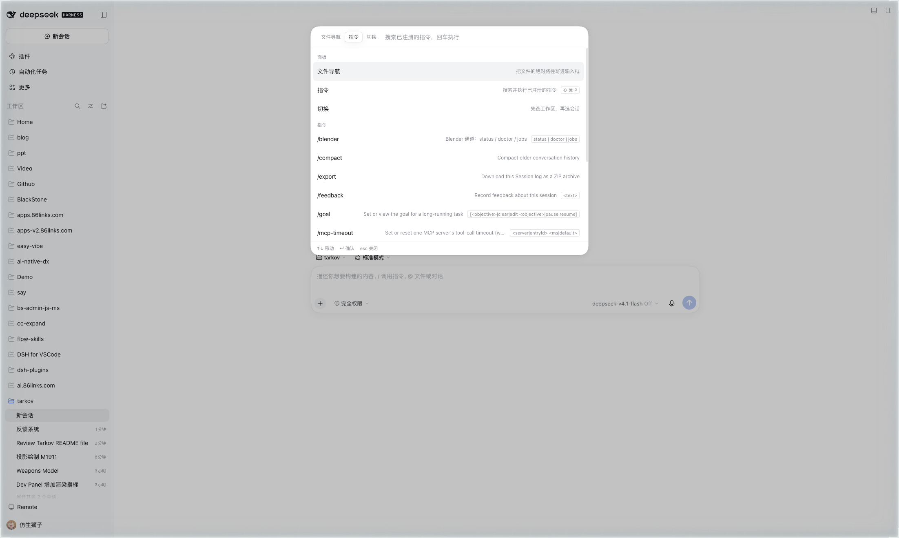

# dsh-command-panel

一个命令面板，把三件事收在一套检索与键盘语义下：

| 模式 | 键 | 做什么 |
| --- | --- | --- |
| 文件导航 | `⌘P` | 在宿主的有界文件索引里搜路径，回车把该文件的绝对路径写到输入框光标处 |
| 指令 | `⌘⇧P` | 搜宿主注册表里的斜杠命令，回车执行；需要参数的命令把 `/name ` 写进输入框 |
| 切换 | `⌘O` | 先选工作区，再选该工作区的会话，选中即切换会话（等同点侧边栏） |

三个模式共用一套规则：打开即有内容、输入即筛选、`↑↓` 移动、`↵` 确认、`esc` 先退一层再关、关闭后焦点还给原处。面板自己也是挂载入口：每个模式里都有另外两个模式的入口行，所以从任意模式都能转到任意模式。



## 安装

包内 `lib/` 是提交入库的构建产物，profile 安装态直接读它、不跑构建。

**web profile**

```sh
dsh plugin --profile web add "link:/Users/lionad/Github/Lionad-Morotar/dsh-plugins/packages/dsh-command-panel"
```

`dsh plugin add` 会同时把包写进 `dsh.profile.bundles`。装完重启该 profile 的宿主进程。

**desktop profile**

desktop profile 由 Electron 应用独占管理，CLI 会拒绝写入。用设置里的插件管理器安装同一个 `link:` 路径，或在应用退出后手工加进 `~/.dsh/profiles/desktop/package.json` 的依赖与 `dsh.profile.bundles`，再 `pnpm install`。两条路都需要重启应用一次。

**手工 patch（不走包管理器时）**

在 profile 的 `cordis.patch.yml` 末尾加：

```yaml
- insert:
    - id: command-panel
      name: 'dsh-command-panel'
```

包的 `cordis.patch.yml` 里已经带了同一条，包管理器安装时不必重复。

## 键位：为什么 `⌘P` 和 `⌘O` 不是声明出来的默认值

宿主的快捷键服务在注册期就用**声明的默认值**校验重叠，且遍历六套 profile，与用户偏好无关。宿主自己已经声明了这两个键：

- `workspace.files` 默认 `⌘P`（侧栏文件树）
- `workspace.add` 默认 `⌘O`（添加工作区）

所以插件若把这两个键写进 `defaults`，注册会直接抛错。本插件的做法是：

1. `⌘⇧P` 在六套 profile 里都空闲，直接声明为默认值，装上即用。
2. `⌘P`、`⌘O` 不声明默认值，改为在激活后问一次服务：`describeBinding` 说这个组合在当前设备上没有 issue、也没有冲突，才写一条与"设置里改键"完全等价的显式覆盖（`shortcuts.edit`）；已被占用就留空并在控制台说明原因，绝不静默挤掉别人的绑定。

因此键位会出现在宿主的快捷键参考面板里，也可以随时在那里改掉。`⌘O` 在本机当前被用户自己绑给了 `session.new`，插件不会去抢；要它接管，给 Loader 行加配置：

```yaml
- id: command-panel
  name: 'dsh-command-panel'
  config:
    takeoverSwitch: true
```

打开后插件会先清掉占用者的显式覆盖，再写下自己的，也就是"设置里按两次"的自动化版本。

Web 端还有一层浏览器限制：宿主白名单不接受 `⌘P`、`⌘O` 这类"单修饰键 + 字母"的组合，所以 web profile 上这两个键不会被绑定（`⌘⇧P` 可以）。web 上要进另外两个模式，从命令模式的第一组行里选即可。

## 行为细节

**打开即有内容**：插件在会话就绪时预取一次文件候选与命令目录，面板打开时先渲染手上的行，再在后台刷新。命令模式在两处保证首帧非空：面板自带的模式行不需要宿主往返。

**插入是追加，不是覆盖**：读写输入框走 session 槽位下发的 `inputActions`，用 `captureInsertion` 拿到的 span 做 CAS 插入，草稿与 `@` 引用 chip 都不动。宿主没下发 actions 时退回服务路径（`conversation.input.for(actx)`），同样按 span 追加；只有在草稿为空时才允许整体写入，所以失败也不会毁掉已输入的内容。插入时按两侧字符决定是否补一个空格，不会和已有文字粘在一起。

**导航模式是一棵树，游标就是查询串**：宿主对含分隔符的查询走实时 `readdir`、空查询列工作区根目录，所以左右键只改写查询文本，不引入第二份"当前目录"状态。`←` 上一级（查询以分隔符结尾时退出该目录，否则丢弃未完成的片段，纯搜索词上不动），`→` 进入高亮目录（把它的相对路径写进查询）。这两个键只在导航模式被接管，其余模式仍是输入框里移动光标；页脚会随模式补出提示。

**`⌘↵` 交给文件面板**：导航模式下对文件行按 `⌘↵`（Windows 上是 `ctrl+↵`），把工作区相对路径交给 `workbench` 服务的 `openView`；同一路径已经开着就激活那个页签，没开着就新开。宿主只把 `openView` 的 focus 能力交给 View More 菜单，菜单没挂载时拿不到，所以先入 `viewFocus` 队列再由文件视图自己取走（见 `dsh-workbench-core` 与 `dsh-fs-explorer` 的 README）。宿主的文件视图没注册时给一句话说明，不静默。

**命令模式先列默认指令**：面板自己的行是声明式的（`catalog.ts` 一条一行，含类别、前置条件、宿主快捷键 id、动作），行文本为 `类别：动作`，所以输入类别词就等于按域筛选。不可用的动作在求解阶段就消失，不留在列表里当死行；有宿主快捷键的动作显示当前生效键帽，读者改键后跟着变。需要参数的动作（重命名）不复制宿主能力，而是把 `/rename ` 写进输入框交给宿主命令。

**两级是"地方"，不是"模式"**：切换模式的第二级按 `esc` 回工作区列表，再按 `esc` 才关面板；这一点由面板自己在 window 捕获阶段接管五个键实现，因为宿主的固定动作也吃 `esc`（双击 `esc` 是中断回复的序列）。

**模态语义借宿主的**：面板根节点带 `role="dialog"`、`aria-modal`、`data-shortcut-modal`，于是宿主自己把其它命令判为 `blocked / reason: "modal"`；焦点、Tab 环绕、`esc` 关闭、关闭还焦交给 `ui-primitives` 的 `useModalLayer`；输入法守卫交给 `observeComposition`（`composing || ended || isComposing || keyCode 229`，其中 `ended` 专治中文上屏那一下回车被误判为确认）。

**数据面全是宿主权威**：文件候选来自 `remote.fileReferences`（宿主有界索引，裸查询模糊排序、含 `/` 走实时目录列举），命令来自 `remote.commands`（`list` 拿目录、`execute` 走宿主自己的分离执行路径，不产生模型消息、不消耗 token），会话与工作区来自 `sessions.list` / `workspaces.list` 快照，切换用 `uiWorkspace.openSession`。归档会话、子代理会话、空白会话一律不出现在任何列表里，与侧栏和 `/resume` 的过滤保持一致。

**会话归属是稀疏的**：`SessionSummary` 没有 `workspaceId`，归属只能由 `WorkspaceView.sessionIds` 反查。本机 1203 个会话里只有 187 个有工作区归属，所以工作区列表末尾必须有"全部会话"和"未分组"两行，否则大多数会话无处可达。

## 已知边界

- 文件候选上限由宿主配置决定（默认 20 条，`maxResults`），插件改不了。导航模式的语义是"在宿主已经排好序的前 20 个候选里再筛"，不是全仓库搜索。
- 文件导航与命令模式都需要一个打开的会话（宿主要求会话被持有并已打开过历史）。没有会话时面板会说明原因，而不是空列表。
- 命令目录拉取偶尔会撞上宿主正在写会话日志（`session/writer-held`）。此时面板保留自己的模式行并把原因放在底部提示里，不会整体退化成错误页。
- 会话列表的宿主顺序是手工顺序而不是最近活跃，第二级按 `updatedAt` 自己重排。

## 开发

```sh
pnpm --filter dsh-command-panel test       # 纯函数与状态机，jsdom 只用于样式注入
pnpm --filter dsh-command-panel typecheck
pnpm --filter dsh-command-panel build      # 产出 lib/，要提交
```

纯逻辑层（`ranking` / `paths` / `panel-state` / `rows` / `claims` / `sources`）不碰 DOM 也不碰服务，测试用 fixture 直接驱动；`runtime` 是唯一的装配点与会话合同实现处，`panel` 只把 store 投影成 DOM。

React 不是本包的依赖：`entry.ts` 在 loader 工厂的 `boot(require)` 里取平台种子（`react`、`react-dom`、`@deepseek-ai/dsh-client-ui-primitives`），构建把这三个声明成 external。
